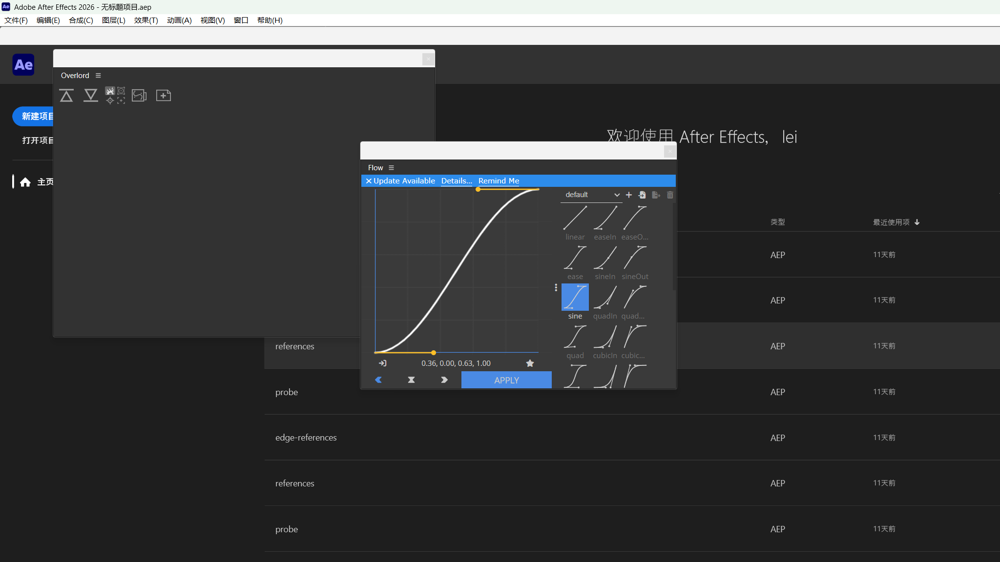
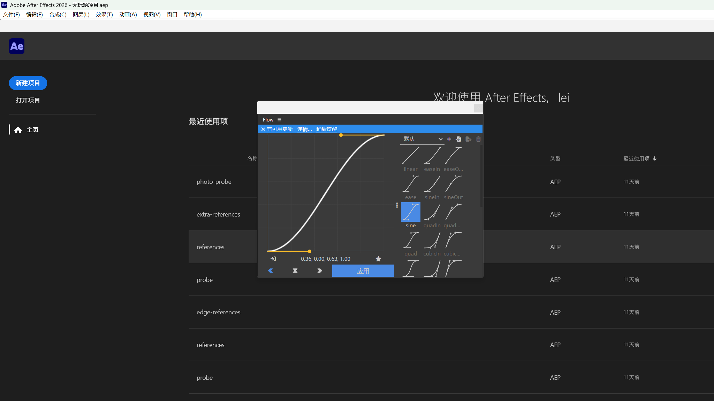
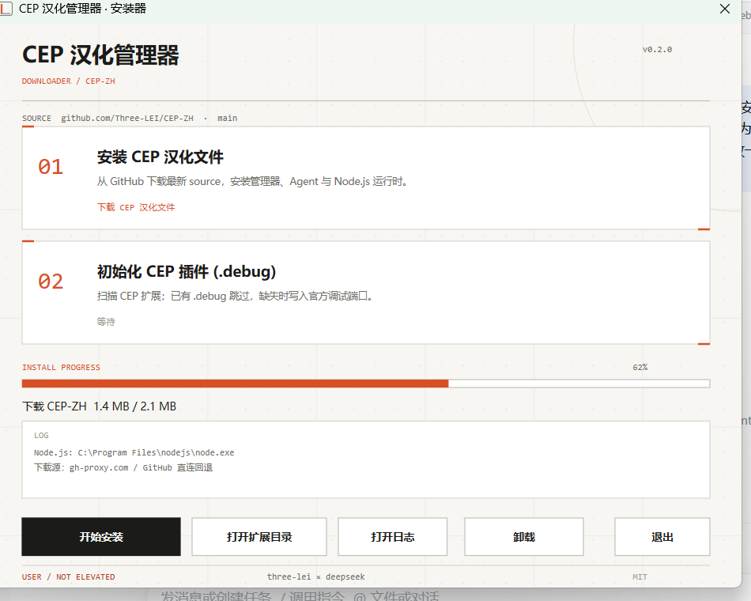
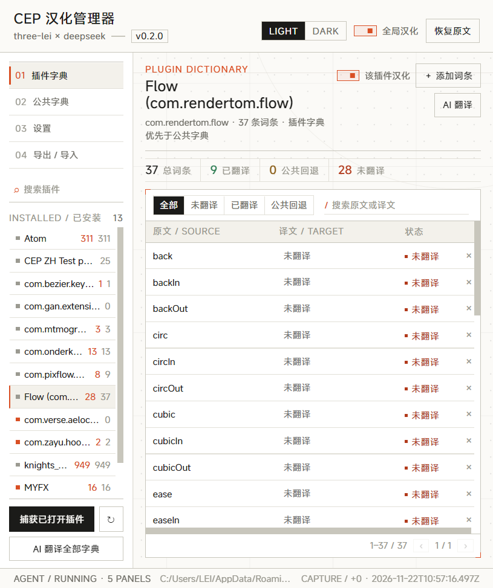
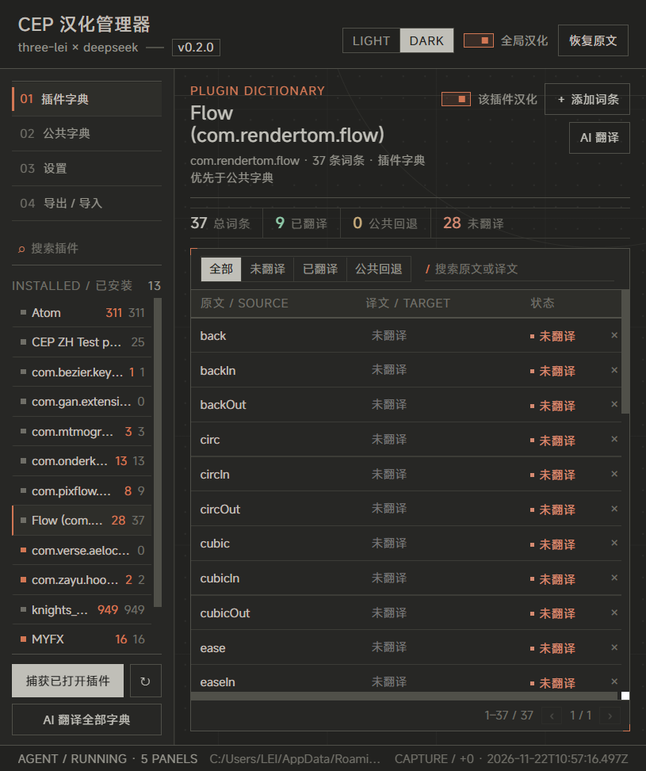
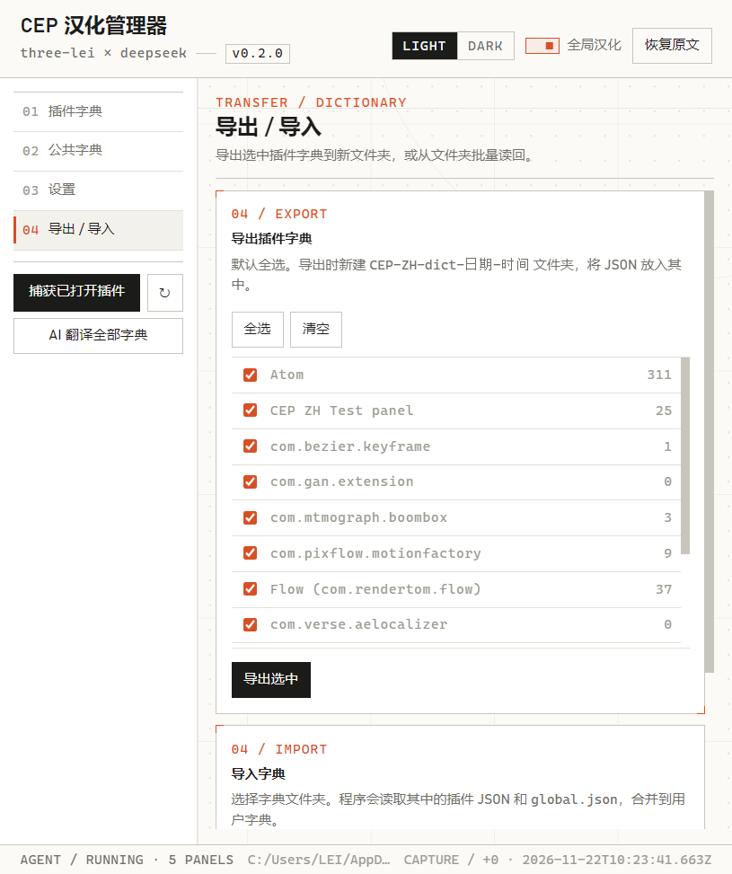
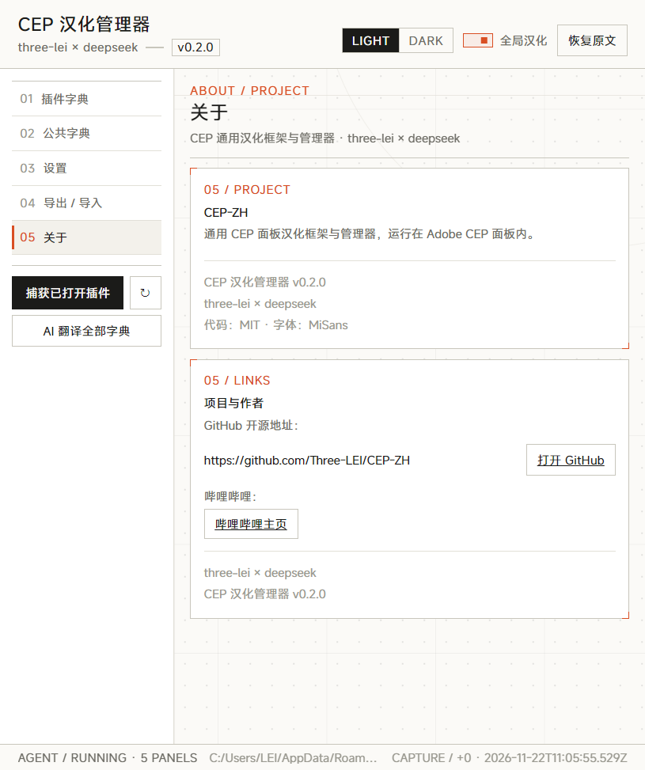

# Adobe CEP 通用注入汉化（cep-zh）

[GitHub 仓库](https://github.com/Three-LEI/CEP-ZH) · [哔哩哔哩主页](https://space.bilibili.com/353544977)

一套**不改扩展源码**的 CEP 面板汉化方案：给每个 CEP 扩展写入官方支持的 `.debug` 远程调试配置，
由常驻 Agent 通过 Chrome DevTools Protocol（CDP）向 `CEPHtmlEngine.exe` 里的面板注入翻译运行时，
在 DOM 层实时替换文本与属性。

已在 **After Effects 2026 (26.5) / CEP 12.0.1 / CEF 99 (Chromium 99)** 上完成端到端验证；
CEP 9–12 的面板都走同一套 `CEPHtmlEngine` + CEF 架构，机制上通用。

版本边界要分清：

- **注入 / 翻译运行时**：CEP 9–12 通用，`.debug` + CDP 即可；AE CC 2019（CEP 9.3.1）已有实测成功反馈；
- **代理 `VCRUNTIME140_1.dll` 引导**：只针对 CEP 12 / CEF 99 的 `cef_settings_t` 布局，
  旧版不要复用同一个 DLL，继续用 `.debug`。AE2019 的 CEP 9 引擎使用 `msvcr120/msvcp120`，
  不会静态加载 `VCRUNTIME140_1.dll`，代理放进去也不会生效。
- 管理面板 UI 在旧版 Chromium 上可能有 CSS 兼容差异；核心注入不受影响。




> 详细架构、证据链、方案对比和限制见 [研究报告](docs/CEP通用注入汉化-研究报告.md)。
>
> **不想逐个扩展配置 `.debug`？** 第二条零 `.debug` 路线已经验证：在 `CEPHtmlEngine` 目录放一个
> 5 KB 的 `VCRUNTIME140_1.dll` 代理，一次安装后所有扩展自动获得调试端口。
> 见 [代理证据](docs/proxy-bootstrap-evidence.md)、[产品架构](docs/产品架构-CEP汉化管理器.md)、
> [DLL 注入实验](docs/dll-injection-notes.md)、[自动启停证据](docs/autostart-evidence.md)。

---

## 0. 两种引导模式

| 模式 | 做法 | 扩展改动 | 管理员 | 适用 |
| --- | --- | --- | --- | --- |
| **A. `.debug`** | 每个扩展根目录写 `.debug` 声明端口 | 每个扩展 1 个文件 | 系统目录需要 | 不想改 Adobe 二进制、或用户目录扩展 |
| **B. 引擎代理** | 每个应用 `CEPHtmlEngine` 目录放 `VCRUNTIME140_1.dll` | **无** | 每应用一次 | CEP 12 / CEF 99；旧版回退 `.debug`（推荐） |

代理模式实测覆盖 AE 2026 真实宿主（7 个面板）、AI 2026 真实面板、PS/PR 2026 引擎；
不再需要 `.debug`。安装方式：

```bat
:: 一次安装（写 Program Files 时需要管理员；D:\Adobe 自定义安装通常可写）
tools\bootstrap\install-proxy.cmd -DryRun
tools\bootstrap\install-proxy.cmd

:: 重启 Adobe 应用；之后直接启动 Agent（会自动采集新面板单词）
node tools\cep-zh\cli.mjs agent
```

### AE2019 / CEP 9–11：用 `.debug`，不要用代理

AE CC 2019 是 CEP 9.3.1，`CEPHtmlEngine.exe` 使用 `msvcr120/msvcp120`，
不会加载 `VCRUNTIME140_1.dll`；即使复制进去也不会执行。旧版请运行：

```bat
:: 默认只处理 AEFT；可加 -Hosts PHXS,PPRO...
powershell -ExecutionPolicy Bypass -File installer\legacy-debug.ps1 -Hosts AEFT -DryRun
powershell -ExecutionPolicy Bypass -File installer\legacy-debug.ps1 -Hosts AEFT

:: 系统扩展目录需要管理员时加 -Elevate
:: 已自带 .debug 的扩展会显示 unchanged
```

然后完全退出并重启 AE，确认 Agent：

```bat
node tools\cep-zh\cli.mjs agent --verbose
```

### 原生安装器（C++ / Direct2D）

面向最终用户的单文件安装器在 [installer/native](installer/native/README.md)。
它不是把 CEP 文件塞进 exe，而是运行时从 GitHub 下载：

- ① 安装管理面板、Agent 与 Node 便携运行时；
- ② CEP12 安装引擎级代理（后续新插件自动生效）；旧版 CEP 扫描 `.debug`，已有跳过，缺失时自动写入；
- 自动创建桌面快捷方式；卸载时恢复/清理 `.debug`、移除扩展与 Agent；
- 固定窗口，不可拉伸/最大化，按屏幕工作区自动缩放；
- 申请管理员权限，写系统扩展目录。

构建产物：`installer/native/dist/CepZhInstaller.exe`（单文件，静态 CRT）。



### 一键本地安装（PowerShell 测试版）

`installer/install.ps1` 会一次完成：扫描 CEP 引擎 → 安装代理 → 安装 Manager/Agent 扩展 →
写 Agent 配置 → 写 HKCU 卸载入口。已在非管理员会话下跑通
install → AE 自动启动/注入 → 字典热更新/实时开关 → uninstall 全流程，
见 [本地测试记录](docs/local-e2e-test.md)。

```bat
:: 只看计划
powershell -NoProfile -ExecutionPolicy Bypass -File installer\install.ps1 -DryRun

:: 安装（D:\Adobe 自定义安装通常不需要管理员；Program Files 需要）
powershell -NoProfile -ExecutionPolicy Bypass -File installer\install.ps1

:: 卸载
powershell -NoProfile -ExecutionPolicy Bypass -File installer\install.ps1 -Uninstall
```

安装后重启 Adobe 应用，打开 `窗口 > 扩展 > CEP 汉化管理`；隐藏的 `cep.zh.agent` 会随宿主启动，
读取 `%APPDATA%\CEP-ZH\config.json` 里的 `nodePath` / `agentScript` 自动拉起 Agent。
当前是外部 Node 原型，Node **18+** 即可（18 没有全局 WebSocket，Agent 自带最小 WS 客户端）。

Manager 已改成明日方舟式“点线面”极简编辑器：

- 点阵 / 细线 / 几何轮廓背景，无渐变玻璃；白色排版参考 [three-lei.cn](https://three-lei.cn/)；
- UI 文本使用 **MiSans**（官方 Regular/Medium WOFF2，未改动；设置页已注明字体许可）；
- 字号随面板尺寸和系统缩放自动调整（`clamp()` + `rem`），窄/矮面板自动紧凑，无需手动设置；
- 默认 **亮色**（更接近 three-lei.cn 的白色排版），右上角 LIGHT / DARK 切换；暗色已降低对比度，不刺眼；
- 标题旁署名 `three-lei × deepseek` 与版本 `v0.2.0`；
- 全局“汉化 / 恢复原文”和单插件开关，Agent 实时响应；
- **新增插件检测**：Agent 每 15 秒重扫；新扩展缺少 `.debug` 时，用户目录自动补写，
  系统目录在管理面板顶部显示横幅/侧栏红点，一键修复（UAC）；
- 字典自动解析成 **虚拟编辑表**（原文 / 译文 / 状态 / 分页），不再手写 JSON；
- **搜索分离**：左侧“搜索插件”只筛插件，表格内“搜索原文或译文”只筛当前字典；
- 插件字典优先，空译文自动回退公共字典；
- Agent 会自动捕获新打开 CEP 面板里的单词，写入插件字典并标为 **未翻译**；
  **纯中文、纯数字、纯符号会被过滤**；也可以点“捕获已打开插件”重新扫描；
- **AI 翻译**：当前插件 / 全部字典两个按钮，只翻译空译文，自动跳过已翻译；
  支持 OpenAI 兼容、DeepL 和本地 mock 测试；
- **04 导出 / 导入**：勾选一个或多个插件字典导出到新文件夹；也可选择文件夹批量导入，
  自动识别插件 JSON 与 `global.json`；
- **05 关于**：项目信息、GitHub 地址与打开按钮、哔哩哔哩主页跳转；









字体来源与许可：[docs/font-license.md](docs/font-license.md)（MiSans 免费商用、允许嵌入，需注明字体）。
公开仓库不提交 WOFF2 原文件；克隆后运行 `python tools/fonts/extract_misans.py` 获取，安装包则已内置。

---

## 1. 原理（一句话）

CEP 的每个面板都是一个独立的 `CEPHtmlEngine.exe`（CEF/Chromium）进程。获得调试端口有两条路：

- 扩展目录的 `.debug` 文件（官方配置，逐扩展）；
- 引擎目录的代理 `VCRUNTIME140_1.dll`（在 `cef_initialize` 前设置 `remote_debugging_port`，逐应用一次）。

拿到的端口由本地 Agent 通过 Chrome DevTools Protocol（CDP）连接，执行：

```js
Page.addScriptToEvaluateOnNewDocument({ source: runtimeJS }) // 页面重载后仍生效
Runtime.evaluate({ expression: runtimeJS })                    // 当前页面立即生效
```

`runtime.js` 用字典 + `MutationObserver` 翻译文本节点和 `title/placeholder/aria-label/data-pt-title`
等属性；支持动态内容、iframe、Shadow DOM，并可热更新字典。

```
┌─────────────┐  CreateProcess   ┌──────────────────────┐
│ AfterFX.exe │ ───────────────> │ CEPHtmlEngine.exe    │
│ (PlugPlug/  │                  │ browser + renderer   │
│  CSXS)      │                  │ + gpu + utility      │
└─────────────┘                  └──────────┬───────────┘
       ▲                                    │ file:///.../index.html
       │ evalScript                         │ CDP (127.0.0.1:port)
       │                                    ▼
┌──────┴───────┐   WebSocket      ┌──────────────────────┐
│ ExtendScript │ <──────────────> │ cep-zh agent (Node)  │
└──────────────┘                  │  + runtime.js + 字典  │
                                  └──────────────────────┘
```

## 2. 目录

```
tools/cep-zh/
  cli.mjs                  # 命令行入口：scan / enable / disable / status / agent / catalog
  agent.mjs                # 常驻注入 Agent（发现端口、CDP 注入、热更新字典）
  runtime/runtime.js       # 注入到面板里的翻译运行时（无依赖，ES5 兼容）
  lib/                     # XML、manifest 扫描、端口分配、.debug 读写、CDP、字典
  dict/global.json         # 全局通用词条
  dict/extensions/*.json   # 按 bundleId / extensionId 命名的词条
  catalog/                 # 从真实面板采集的英文字符串（用于翻译）
  cep-zh.cmd               # Windows 包装脚本
samples/cep.zh.test/       # 用于验证的测试面板（含动态文本、iframe、Shadow DOM）
product/cep.zh.manager/    # 宿主内管理面板原型（字典/API 编辑）
installer/install.ps1      # 本地一键安装/卸载（测试版，尚未打包）
tools/bootstrap/           # 引擎代理源码、二进制、安装器
docs/                      # 研究报告、产品架构、证据、截图
```

## 3. 环境要求

- Windows（本方案在 Windows 11 上验证；macOS 路径不同但 CEP/CDP 机制一致）
- Node.js **18+**（18 使用内置 `lib/ws.mjs`，22+ 使用原生 `fetch` / `WebSocket`）
- Adobe 应用 + CEP 扩展；本机已安装 AE 2024/2025/2026
- 写 `C:\Program Files*\Common Files\Adobe\CEP\extensions` 需要**管理员权限**；
  `%APPDATA%\Adobe\CEP\extensions` 与 `D:\Adobe\...\Support Files` 下的扩展普通权限即可

## 4. 快速开始

```bat
:: 0) 查看会处理哪些扩展（默认只处理本机已安装的宿主：AE/PR/PS/AI…）
node tools\cep-zh\cli.mjs scan --hosts AEFT

:: 1) 写入 .debug（只处理名称含 flow 的扩展；可加 --dry-run 先看计划）
node tools\cep-zh\cli.mjs enable --hosts AEFT --only flow

::    系统目录被跳过时，用管理员终端重跑；或：
node tools\cep-zh\cli.mjs enable --hosts AEFT --elevate

:: 2) 完全退出并重启 After Effects（.debug 在扩展加载时读取）

:: 3) 启动常驻 Agent；打开任意 CEP 面板即可看到中文，并自动收集新单词
node tools\cep-zh\cli.mjs agent --verbose
```

> 已经自带 `.debug` 的扩展（Flow、Overlord、FreqReact、Easify 等）**不需要**执行 `enable`，
> 直接启动 `agent` 就能注入；`enable` 只会显示 “unchanged”。

`enable` 会：

- 解析所有扩展的 `CSXS/manifest.xml`，按 `扩展ID × 宿主` 分配稳定的本地端口（默认 39300 起）；
- 保留扩展开发者已有的 `.debug` 端口，只补缺失项；
- 首次写入前备份原文件为 `.debug.cep-zh.bak`，把状态写入 `tools/cep-zh/state.json`；
- 跳过无写权限的系统目录并给出提示。

`agent` 会：

- 用 `tasklist` + `netstat` 找到 `CEPHtmlEngine.exe` 监听的 loopback 调试端口；
- 用 URL/端口映射回扩展与字典；
- 通过 CDP 注入 `runtime.js`，并在 `Page.frameNavigated` / 字典变更时重新注入；
- 面板打开/重载时自动调用 `off()` 还原英文，提取文本/属性，把缺失单词以空译文写进
  `%APPDATA%\CEP-ZH\dict\extensions\<bundleId>.json`，供管理器表格填写；
- 不会覆盖已有译文；公共字典里已有译文的词不会重复写入插件字典。

## 5. 字典与翻译流程

`dict/global.json`（所有扩展共用）：

```json
{
  "strings": {
    "Apply": "应用",
    "Cancel": "取消",
    "Details…": "详情…"
  }
}
```

`dict/extensions/<bundleId>.json`（按扩展覆盖，支持正则）：

```json
{
  "name": "Flow",
  "strings": {
    "APPLY": "应用",
    "default": "默认",
    "Update Available": "有可用更新"
  },
  "patterns": [
    { "re": "^Frames rendered: (\\d+)$", "to": "已渲染帧数：$1" }
  ]
}
```

推荐流程：

1. 打开目标面板（英文），运行 `node tools\cep-zh\cli.mjs catalog --all`
   → 生成 `catalog/<bundleId>.json`，里面是去重后的英文文本/属性及出现次数；
2. 把翻译写进 `dict/extensions/<bundleId>.json`；
3. Agent 检测到字典变化后 **~0.4 秒内热更新**，无需重启面板；
4. `catalog` 里出现频次低、明显是变量内容的字符串，优先用 `patterns` 处理（如帧数、版本号）。

## 6. 命令

| 命令 | 说明 |
| --- | --- |
| `scan [--hosts AEFT,PPRO] [--only flow] [--json]` | 扫描扩展、宿主、`.debug` 状态、可写性 |
| `enable [--hosts ...] [--only ...] [--start 39300] [--dry-run] [--elevate]` | 分配端口并写入 `.debug` |
| `disable` | 校验哈希后恢复备份 / 删除生成的 `.debug` |
| `status [--json]` | 显示已启用文件数、当前活跃面板及端口映射 |
| `agent [--once] [--verbose]` | 常驻注入；`--once` 只注入当前快照 |
| `catalog [--all] [--port 39210]` | 采集当前面板的英文文本 |
| `translate --catalog ... --bundle ... --provider openai|deepl|mock [--write]` | 用翻译 API 把 catalog 变成字典 |

`--only` 是**子串或 `/正则/`** 匹配，匹配 `bundleId / 路径 / 扩展ID / 菜单名`。
例如 `--only flow` 也会命中 `CamFlow`；要精确匹配用 `--only /^com\.rendertom\.flow$/`。

### 6.1 接入翻译 API

配置（Manager 的“翻译 API”页也会写这个文件）：

```text
%APPDATA%\CEP-ZH\config.json
{
  "provider": "openai",
  "baseUrl": "https://api.deepseek.com",
  "model": "deepseek-flash",
  "apiKey": "sk-...",
  "targetLang": "zh-CN"
}
```

```bat
:: 先把当前面板的英文采集到 catalog/
node tools\cep-zh\cli.mjs catalog --all

:: 机器翻译（先输出到 .auto.json，检查后再 --write 合并进正式字典）
node tools\cep-zh\translate.mjs --catalog tools\cep-zh\catalog\com.rendertom.flow.json ^
  --bundle com.rendertom.flow --provider openai

:: 无 Key 时可用 mock 验证链路
node tools\cep-zh\translate.mjs --catalog tools\cep-zh\catalog\com.rendertom.flow.json ^
  --bundle com.rendertom.flow --provider mock
```

- `openai` 走 OpenAI 兼容 `/chat/completions`（DeepSeek/OpenAI 等）；
- `deepl` 走 DeepL `/v2/translate`；
- 结果缓存到 `tools/cep-zh/cache/translate.json`（原文 hash + provider + 目标语言）；
- `--write` 合并到 `dict/extensions/<bundle>.json`，运行中的 Agent 会热重载。

## 7. 还原与安全

```bat
node tools\cep-zh\cli.mjs disable
:: 重启 Adobe 应用，调试端口不再打开
```

- `.debug` 是 CEP 官方支持的远程调试配置；**不修改任何扩展 HTML/JS，不替换任何 Adobe 二进制**。
- 调试端口只绑定 `127.0.0.1`，但本机任意进程都能连上并执行面板 JS，
  而面板 JS 可以通过 `evalScript` 调用宿主 ExtendScript。**仅在可信环境使用**；不用时执行 `disable` 并重启应用。
- `enable` 会记录文件哈希；如果 `.debug` 被其他人改过，`disable` 会跳过并提示，避免覆盖。

## 8. 已验证 / 已知限制

已验证：

- **管理面板**：点线面极简表格编辑器、MiSans 字体、自动字号适配、默认亮色/低对比暗色、全局与单插件开关、恢复原文、自动捕获单词；
- **开关速度**：`control.json` 由 `fs.watch` 监听 + 并行 CDP off/on，实测全局切换 **约 60 ms**（58–65 ms）；
- **AI 翻译**：mock 实测当前插件 +28 条、全部字典 +1290 条，均跳过已有译文；
- **导出 / 导入**：导出 12 个插件字典到新文件夹，再从文件夹导入 12 个文件 / 50 条译文；
- **捕获过滤**：纯中文、纯数字、纯符号不进入字典；
- **自动缩放**：字号随面板/系统缩放自动调整，无手动缩放控件。
- **单词收集**：新开 CEP 面板自动提取文本/属性写入插件字典，空译文显示“未翻译”，
  显式捕获只补缺失词条、不覆盖已有翻译；
- **旧版 CEP**：AE CC 2019 / CEP 9.3.1 的 `.debug` 路线已有实测成功反馈；代理 DLL 仍只针对 CEP 12；
- Flow / Overlord / 自建测试面板的文本与属性翻译；
- 动态文本（每 900ms 更新）、`patterns` 正则、iframe、Shadow DOM；
- 面板 `location.reload()` 后由常驻 Agent 自动重新注入；
- 字典热更新、`catalog` 采集、`enable → 重启 → 注入 → disable` 全流程；
- 同一端口被两个扩展开发者同时声明（Flow 与 Easify 都写 8092）时，按面板 URL 纠正映射。

限制（详见研究报告）：

- **原生菜单/标签页标题**（`窗口 > 扩展 > Flow`、面板标签 “Flow”）由宿主绘制，不在 DOM 中；
  `document.title` / `setWindowTitle` 在 AE 2026 上不会改变面板标签，需要改 manifest 的 `<Menu>`
  并配合 CEP 的 `locale/` 机制（会触碰扩展文件与签名）。
- Canvas/WebGL 里绘制的文字无法用 DOM 方案翻译。
- 管理面板的 AI 翻译已接 mock；真实 Key 的 OpenAI/DeepL 调用待用真实账号验证。
- 导出/导入使用 CEP 原生文件夹选择框；批量导入会合并到用户字典，默认不覆盖已有译文。
- 管理面板在 AE 里被停靠得很小时，表格只显示少量行；拉大面板或单独浮动即可获得完整编辑器布局。
- 全局汉化快捷键未内置；CEP 面板内快捷键无法在宿主失焦时生效，系统级热键需要额外原生辅助程序。
- MiSans 字体文件随扩展嵌入，约 9.8 MB；字体本身不可单独再分发，详细许可见
  [docs/font-license.md](docs/font-license.md)。
- 跨域 iframe 无法访问；同源 `file://` iframe 可以。
- 需要重启应用才能让新 `.debug` 生效；扩展升级可能删除 `.debug`，升级后重跑 `enable`。
- 系统级扩展目录需要管理员权限。

## 9. 故障排查

**Manager 面板只有标签页、内容空白**

- 原因：Manager 的 `AutoVisible` 被设为 `false`。CEP 只创建了 tab，内嵌 CEPHtmlEngine 窗口不显示；
  DOM 实际已加载（用 CDP 能看到内容），但宿主画的是空面板。
- 修复：`product/cep.zh.manager/CSXS/manifest.xml` 里 manager 扩展保持
  `<AutoVisible>true</AutoVisible>`（隐藏 Agent 仍为 `false`），重新安装扩展并重启 Adobe。

**某个面板不汉化，其他正常**

- 先看 `%TEMP%\cepzh-proxy.log` 是否为每个 CEP 浏览器进程分配了唯一端口；
- 旧版代理用 `39600 + PID%500`，可能两个进程撞同一端口（例如 Flow 与 AE Localizer 都落到 39748），
  其中一个没有 DevTools 端口，Agent 无法注入；
- 更新 `tools/bootstrap/dist/VCRUNTIME140_1.dll`（已加入命名互斥量占位），重新安装代理并重启。
- 若多个 Adobe 应用同时运行，Agent 目前不按宿主 PID 过滤，可能重复注入；这是已知限制。

**Agent 没有启动**

- 查 `%APPDATA%\CEP-ZH\agent\status-*.json` 和 `agent.log`；
- 确认 `%APPDATA%\CEP-ZH\config.json` 的 `nodePath` 指向 Node **18+**，`agentScript` 指向
  `%LOCALAPPDATA%\CEP-ZH\agent\tools\cep-zh\agent.mjs`；
- Node 18 没有全局 WebSocket，Agent 已内置 `lib/ws.mjs`；如果仍然失败，看 agent.log 的错误。
