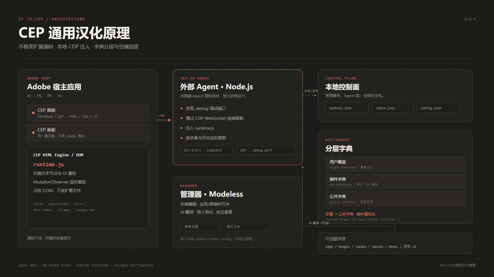

# ZyYu-CEP通用汉化管理

Adobe CEP 面板通用汉化方案：**不修改扩展源码**，通过本地调试协议注入运行时，实现字典驱动的界面翻译、全局/单插件开关和 AI 辅助翻译。

<p align="center">
  
</p>

## 原理

CEP 面板本质上是运行在 Adobe 宿主中的 Chromium 页面。项目不替换扩展文件，而是把运行时注入到页面 DOM 中：

1. Adobe 启动时，隐藏的 Agent 面板拉起一个独立的 Node.js Agent。
2. Agent 发现 CEP 面板的 `.debug` 调试端口，通过本地 CDP WebSocket 连接到面板。
3. Agent 注入 `runtime.js`；运行时扫描文本节点和 `title`、`placeholder`、`aria-*` 等 UI 属性。
4. 运行时按字典替换文案，并用 `MutationObserver` 持续处理面板重绘。
5. 管理器通过本地文件控制开关、字典和翻译任务，不与 Adobe 源码耦合。

字典按优先级合并：

```text
用户覆盖 > 插件字典 > 公共字典
```

插件译文为空时回退到公共字典，因此空值不会遮挡公共回退。

## 功能

- 不修改扩展源码，运行时注入汉化
- 公共字典 + 插件字典 + 用户覆盖，空值自动回退
- 全局汉化开关、单插件开关
- 管理器内编辑、导入导出、自动捕获面板词条
- 表格视图 / 逐行文本视图；逐行文本可多选复制到网页 AI
- 字典热更新、运行时开关
- 可选翻译源：Edge、Google、Yandex、OpenAI 兼容接口、DeepL
- 支持 CEP 9–12，兼容 Adobe 2019 或更新版本

## 兼容范围

- **支持：** Adobe 2019 或更新版本（After Effects / Photoshop / Premiere Pro / Illustrator 等 CEP 面板；CEP 9–12）
- Windows 10 / 11
- 管理面板是独立 Modeless 窗口，不参与宿主停靠面板组
- Adobe 2019 使用 CEP 9；旧版布局与 CDP 兼容已处理

## 安装

1. 关闭所有 Adobe 应用。
2. 下载最新版安装器：

   [下载 CepZhInstaller.exe](https://github.com/Three-LEI/CEP-ZH/releases/latest)

3. 以管理员身份运行，按提示安装管理器、Agent 和 Node 运行时。
4. 初始化 CEP 插件调试端口。
5. 重启 Adobe 应用。

日常使用不需要一直打开管理器；隐藏 Agent 会随 Adobe 启动。

## 使用

打开管理器：

```text
窗口 > 扩展 > ZyYu-CEP通用汉化管理
```

- `全局汉化`：控制全部插件
- `仅该插件汉化`：只控制当前选中的插件
- `表格`：逐条编辑，分页显示
- `逐行文本`：当前筛选结果全部词条放入一个文本框，每行 `原文=译文`；可复制到网页 AI
- `复制网页端提示词`：复制预置的网页翻译提示词

API Key 获取、配置和测试步骤见：

[API-KEY-GUIDE.md](API-KEY-GUIDE.md)

## 目录

```text
product/cep.zh.manager   管理面板（HTML / CSS / JS）
tools/cep-zh             Agent、CLI、运行时和字典
tools/elevate            管理员写入助手
installer/native         C++ 安装器
assets/                  架构图与仓库图片
```

## 构建

安装器构建：

```powershell
powershell -ExecutionPolicy Bypass -File installer\native\scripts\build.ps1
```

发布包构建：

```powershell
powershell -ExecutionPolicy Bypass -File scripts\release.ps1
```

## 许可

代码使用 MIT License。

界面使用 MiSans 时遵循小米字体许可；公开仓库不单独分发 WOFF2 字体文件。
