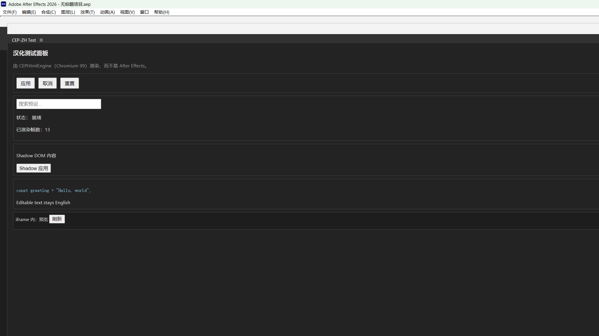
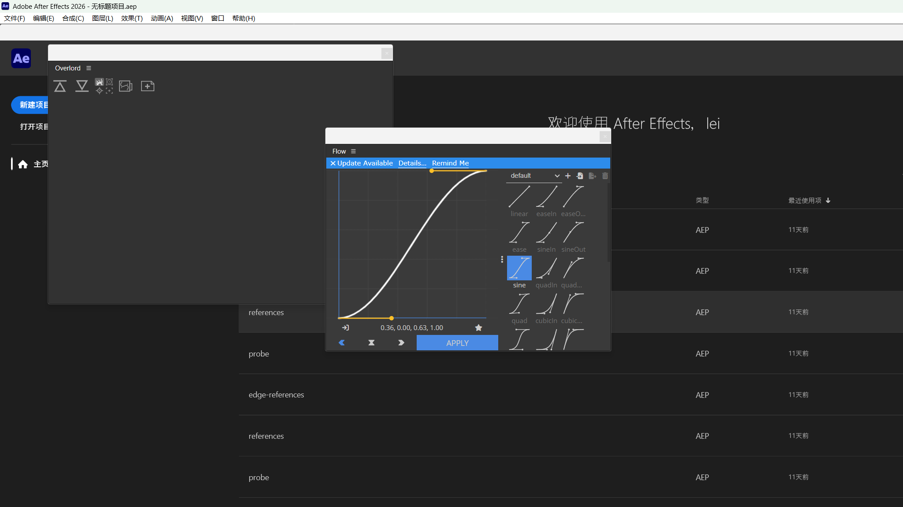
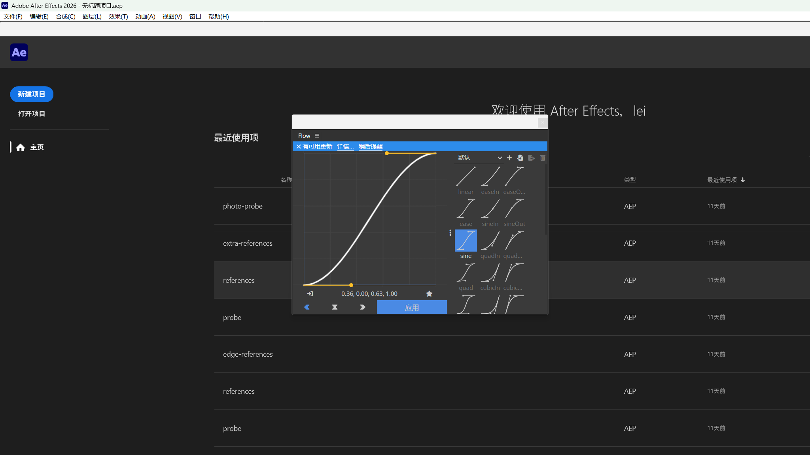

# Adobe CEP 通用注入汉化方案研究报告

> 实验对象：After Effects 2026 (26.5)，CEP 12.0.1，CEF 99 / Chromium 99  
> 实验机器：Windows 11 中文版，Adobe 安装在 `D:\Adobe`，扩展分布在 `C:\Program Files*` 与 `%APPDATA%`  
> 代码与工具：`tools/cep-zh/`；验证截图：`docs/screenshots/`；原始证据：`docs/evidence.md`

---

## 摘要

本研究的核心结论有三点：

1. **CEP 面板不是由 After Effects 的原生 UI 渲染的**，而是每个扩展一个独立的
   `CEPHtmlEngine.exe` 进程，内部是 CEF 3（Chromium 99）浏览器。面板内容是普通 HTML/JS，
   因此“汉化”本质上是对 DOM 做运行时替换，而不是修改 AE 的界面资源。
2. CEP 官方支持在扩展根目录放一个 **`.debug`** 文件声明远程调试端口；CEP 会把它变成
   `CEPHtmlEngine.exe --remote-debugging-port=<port>`。这是**不需要改扩展代码、不需要注入 DLL、
   不需要替换二进制**的稳定注入通道：本地 Agent 用 Chrome DevTools Protocol（CDP）即可在
   任意面板里执行 JS，并且可以用 `Page.addScriptToEvaluateOnNewDocument` 覆盖后续刷新。
3. 基于该通道实现的 `cep-zh` 工具已经跑通完整闭环：
   **扫描扩展 → 分配端口并写 `.debug` → 重启应用 → Agent 自动发现面板 → CDP 注入翻译运行时 →
   字典热更新 / 页面重载自动续注入 → 一键还原**。在 Flow、Overlord 和自建测试面板上验证了
   静态文本、属性、动态文本、正则、iframe、Shadow DOM 与页面重载。

代价与边界同样明确：系统级扩展目录需要管理员权限；新 `.debug` 需要重启应用才生效；
原生菜单/标签页标题不在 DOM 中；调试端口虽然只绑定 `127.0.0.1`，但本机任意进程都能借它
在面板里执行 JS，因此必须按“高权限调试接口”对待。

---

## 1. 实验环境与证据来源

| 项 | 值 |
| --- | --- |
| 宿主 | Adobe After Effects 2026，`AfterFX.exe` 26.5 |
| CEP | PlugPlug / CSXS **12.0.1** |
| HTML 引擎 | `D:\Adobe\Adobe After Effects 2026\Support Files\CEPHtmlEngine\CEPHtmlEngine.exe` 12.0.1 |
| CEF | `libcef.dll` 99.2.15+g71e9523+chromium-99.0.4844.84 |
| 浏览器标识 | `Chrome/99.0.4844.84 AdobeCEP/12.0.1`（来自 `/json/version`） |
| 扩展根 | `C:\Program Files\Common Files\Adobe\CEP\extensions`、`C:\Program Files (x86)\...`、`%APPDATA%\Adobe\CEP\extensions`、各应用 `Support Files` 下的内置扩展 |
| 本机扫描结果 | 约 108–109 个 bundle、86–87 个 extension id（含 CC Libraries 多版本、内置扩展；测试扩展安装时多 1 个） |

官方文档依据：

- [Adobe-CEP/CEP-Resources](https://github.com/Adobe-CEP/CEP-Resources)
- [CEP 12 HTML Extension Cookbook](https://github.com/Adobe-CEP/CEP-Resources/blob/master/CEP_12.x/Documentation/CEP%2012%20HTML%20Extension%20Cookbook.md)
  - “CEP HTML engine is based on Chromium Embedded Framework version 3 (CEF3)…”
  - “Each CEP extension runs in a separate CEP HTML Engine… one main/browser process, one renderer process, and one GPU process.”
  - “Create a `.debug` file to the extension root directory… The .debug file contains remote debug ports.”
  - “If you load an extension whose debug port is 8088, you can load the debugger through http://localhost:8088/.”
  - CEF 命令参数表对 `--remote-debugging-port` 的说明：“This could overwrite the one in .debug file. Filter out to avoid conflict.”

---

## 2. CEP 的渲染来源：CEPHtmlEngine，而不是宿主 UI

### 2.1 进程模型

启动 AE 并打开扩展后，进程列表里出现一组 `CEPHtmlEngine.exe`。它们不是一个进程，而是
**每个扩展一套 Chromium 多进程**：

```
AfterFX.exe (PID 20040)
├─ CEPHtmlEngine.exe  <mainPath> <uuid> 20040 AEFT 26.5 <extId> 6 "<extPath>" "AE_CApplication_26.5" 16 <base64 CEF flags> zh_CN ...   ← browser
│  ├─ CEPHtmlEngine.exe --type=renderer ... --params_extensionid=... --remote-debugging-port=8092   ← 渲染面板 DOM
│  ├─ CEPHtmlEngine.exe --type=gpu-process ...
│  └─ CEPHtmlEngine.exe --type=utility --utility-sub-type=network.mojom.NetworkService ...
```

实测的 browser 进程命令行（Flow）：

```text
"D:\Adobe\Adobe After Effects 2026\Support Files\CEPHtmlEngine\CEPHtmlEngine.exe"
"C:\Program Files (x86)\Common Files\Adobe\CEP\extensions\flow\panel\index.html"
1a34d787-ade5-48f7-bcd9-d1f9e6b2b751 20040 AEFT 26.5
com.rendertom.flow 6
"C:\Program Files (x86)\Common Files\Adobe\CEP\extensions\flow"
"AE_CApplication_26.5" 1
WyItLWVuYWJsZS1ub2RlanMiLCItLWFsbG93LWZpbGUtYWNjZXNzLWZyb20tZmlsZXMiLCItLWFsbG93LWZpbGUtYWNjZXNzIiwiLS1taXhlZC1jb250ZXh0Il0=
zh_CN 4281479730 100 0
```

可读出的信息：

- 第一个参数就是面板 HTML 的**绝对路径**；
- 后面依次是实例 UUID、宿主 PID、宿主 ID（`AEFT`）、宿主版本、扩展 ID、CEP 运行时版本、
  扩展根目录、应用标识；
- 第 11 个参数是 base64 编码的 CEF 命令行开关数组（解码后是
  `["--enable-nodejs","--allow-file-access-from-files","--allow-file-access","--mixed-context"]`）；
- 再往后是 locale、DPI 等。

renderer 进程命令行的关键片段：

```text
--type=renderer
--params_extensionid=com.rendertom.flow
--params_loglevel=6
--params_serverid=20040
--remote-debugging-port=8092
--lang=zh-CN
```

### 2.2 面板窗口如何进入 AE

`CEPHtmlEngine.exe` 里存在 `CefController::HandleWindowEvent: SetParent() failed for handle %d`
这类字符串，配合实际现象（面板作为 AE 的子窗口/标签出现、随 AE 主窗口移动），可以确认
CEPHtmlEngine 创建自己的原生窗口后，由 CEP 把它 **SetParent 嵌入宿主窗口**。
但渲染仍然发生在 CEPHtmlEngine 进程里，宿主只提供窗口容器和菜单/标签等 chrome。

### 2.3 渲染内容的性质

用 CDP 读面板：

```json
{
  "Browser": "Chrome/99.0.4844.84",
  "Protocol-Version": "1.3",
  "User-Agent": "Mozilla/5.0 ... Chrome/99.0.4844.84 AdobeCEP/12.0.1 Safari/537.36",
  "V8-Version": "9.9.115.10"
}
```

```json
{
  "title": "Flow",
  "type": "page",
  "url": "file:///C:/Program%20Files%20(x86)/Common%20Files/Adobe/CEP/extensions/flow/panel/index.html",
  "webSocketDebuggerUrl": "ws://127.0.0.1:8092/devtools/page/D428..."
}
```

结论：

- 面板是 `file://` 页面，DOM、CSS、JS 都在 CEPHtmlEngine 的 renderer 里；
- 面板可以访问 `window.__adobe_cep__`、`CSInterface`，通过 `evalScript` 调宿主 ExtendScript；
- **能改 DOM 就能汉化面板内容**；
- 但面板标签标题、`窗口 > 扩展 > ...` 菜单项由 PlugPlug/宿主绘制，**不在 DOM 中**，
  DOM 注入无法改它们（第 8 节讨论）。

---

## 3. `.debug`：CEP 官方的远程调试入口

### 3.1 文件格式

扩展根目录（与 `CSXS/` 同级）放 `.debug`：

```xml
<?xml version="1.0" encoding="UTF-8"?>
<ExtensionList>
  <Extension Id="com.overlord.panel">
    <HostList>
      <Host Name="ILST" Port="8052" />
      <Host Name="AEFT" Port="8053" />
    </HostList>
  </Extension>
</ExtensionList>
```

- 一个 bundle 可以有多个 `<Extension Id>`，每个扩展、每个宿主一个端口；
- 端口范围 1024–65534；
- 文件读取发生在**扩展加载时**，所以新增/改端口后要重启宿主应用；
- 扩展开发者常自带这个文件（Overlord、Flow、FreqReact、Easify、CamFlow 等本机都有）。

### 3.2 实测链路

1. 给测试扩展写入 `.debug`（AEFT:39300）并重启 AE；
2. `CEPHtmlEngine.exe` 的 renderer 命令行出现 `--remote-debugging-port=39300`；
3. browser 进程在 `127.0.0.1:39300` 监听；
4. `GET http://127.0.0.1:39300/json` 返回面板的 `webSocketDebuggerUrl`；
5. CEP 日志出现：
   ```text
   DevTools listening on ws://127.0.0.1:39300/devtools/browser/...
   TEST-LOADEXTENSION-PERFORMANCE, CEPHTMLENGINE, CreateBrowser begin.
   ```
6. 用 WebSocket 连上后 `Runtime.evaluate` 可以读取/修改 DOM，`Page.addScriptToEvaluateOnNewDocument`
   可以在页面刷新时自动执行。

同一机制在 Overlord（8033/8053）、Flow（8092）上重复验证。

### 3.3 为什么不用 manifest 的 `CEFCommandLine`

manifest 里可以写：

```xml
<CEFCommandLine>
  <Parameter>--remote-debugging-port=9222</Parameter>
</CEFCommandLine>
```

但 Cookbook 明确说明该参数会被过滤，以免覆盖 `.debug` 的端口；而且即使可用，也要改每个
manifest，和“通用注入”目标冲突。`.debug` 是专门为调试端口设计的，干净且可逆。

---

## 4. 注入面比较

| 方案 | 通用性 | 侵入性 | 权限 | 稳定性 | 结论 |
| --- | --- | --- | --- | --- | --- |
| **`.debug` + CDP（本方案）** | 所有 CEP 9–12 扩展 | 只在扩展根加 1 个小 XML | 系统目录需管理员 | 官方调试通道，面板刷新可续注入 | **采用** |
| 修改 `MainPath` HTML 插入 `<script>` | 所有扩展 | 改扩展源文件，破坏签名/升级 | 系统目录需管理员 | 直接、无端口；但每扩展都要改，升级丢失 | 备用/离线方案 |
| manifest 的 `CEFCommandLine` | 每扩展单独 | 改 manifest | 需管理员 | 端口参数被 CEP 过滤 | 不可行 |
| 替换 `CEPHtmlEngine.exe` 为启动器，追加 `--remote-debugging-port` | 所有扩展/所有应用 | 替换 Adobe 二进制 | 需管理员 | 升级覆盖、签名/AV 风险 | 理论可行，未采用 |
| DLL 代理/注入 CEPHtmlEngine | 所有扩展 | 原生 DLL，版本相关 | 同用户可注入但实现复杂 | 最脆弱，AV 高风险 | 不推荐 |
| CEP `locale/` + `<Menu>%key</Menu>` | 只对菜单/已支持扩展 | 改 manifest + locale 文件 | 需管理员 | 官方本地化机制 | 用于原生菜单的补充 |

选择 `.debug` + CDP 的核心理由：

- **零扩展代码修改**：不动 HTML/JS，翻译逻辑集中在 Agent；
- **签名友好**：`.debug` 不在 `META-INF/signatures.xml` 的签名清单里，实测签名的 Overlord 照常加载；
- **可逆**：备份 + 哈希校验，`disable` 可精确还原；
- **可观测**：CDP 是标准协议，调试、采集、注入共用一条通道；
- **可扩展**：同一 Agent 可以顺便做字符串采集、截图、性能统计、面板自动化。

---

## 5. 通用方案设计

### 5.1 总体结构

```
scan  ──►  enable  ──►  (重启应用)  ──►  agent  ──►  面板中文
  │           │                          │
  │           ├─ 端口分配                 ├─ tasklist/netstat 发现端口
  │           ├─ 合并 .debug              ├─ URL → bundle/扩展
  │           └─ 备份 + state.json        ├─ CDP attach + inject
  │                                       ├─ 字典热更新 / 页面导航续注入
  └─ 解析 manifest                        └─ catalog 采集
```

### 5.2 扫描（scan）

- 默认根：
  - `%APPDATA%\Adobe\CEP\extensions`
  - `C:\Program Files\Common Files\Adobe\CEP\extensions`
  - `C:\Program Files (x86)\Common Files\Adobe\CEP\extensions`
  - `D:\Adobe\*\Support Files` / `Required` / `Contents` 下的应用内置扩展（可配置）
- 每个 bundle 解析 `CSXS/manifest.xml`：`ExtensionBundleId`、`HostList`、`ExtensionList`、
  `DispatchInfoList`、`MainPath`、`Menu`、`CEFCommandLine`、`AutoVisible`。
- 同时读出已有 `.debug`，记录每个扩展/宿主的现有端口。
- 本机结果：109 个 bundle、87 个 extension id；大量 CC Libraries 多版本和 AE 2024/2025/2026
  内置扩展会造成同一 extension id 出现在多个目录，端口按 `extensionId × host` 共享。

### 5.3 端口分配与 `.debug` 写入（enable）

- 默认从 39300 起，范围到 45999；跳过：
  - 已有 `.debug` 里声明的端口（保留开发者配置）；
  - 当前正在监听的端口；
  - 已分配端口。
- 同一 `extensionId × host` 在多个 bundle 中复用同一端口，避免同一宿主加载两份时冲突。
- 写入前：
  - 目录可写性探测（临时文件）；
  - 原 `.debug` 备份为 `.debug.cep-zh.bak`；
  - 合并而不是覆盖：保留原有 `<Extension>`/`<Host>` 条目，只补缺失项。
- 状态文件 `state.json` 记录：每个 `.debug` 的路径、备份、写入哈希、涉及的扩展 ID/宿主。
- 系统目录不可写时：
  - 跳过并列出；
  - 返回码 3；
  - 提示用管理员终端重跑，或 `--elevate` 触发 UAC。
- 本机实测：AE 相关 80 个 bundle 中 26 个可写（`%APPDATA%` + `D:\Adobe` 自定义安装），
  54 个位于 `C:\Program Files*`，需要管理员。

示例生成文件：

```xml
<?xml version="1.0" encoding="UTF-8"?>
<!-- generated/merged by cep-zh (Adobe CEP universal injection localizer) -->
<ExtensionList>
  <Extension Id="cep.zh.test.panel">
    <HostList>
      <Host Name="AEFT" Port="39300" />
    </HostList>
  </Extension>
</ExtensionList>
```

### 5.4 Agent 发现面板

每 2 秒：

1. `tasklist /FI "IMAGENAME eq CEPHtmlEngine.exe"` 拿到所有 CEP 引擎 PID；
2. `netstat -ano` 过滤 `LISTENING` 且 local address 为 `127.0.0.1`/`[::1]` 的端口；
3. 对每个端口 `GET /json`，有 `type=page` 即一个可注入面板；
4. 端口 → 扩展的映射：
   - 优先用面板 URL 与扩展 `basePath` 的最长前缀匹配（**URL 是权威**）；
   - 再用 `.debug` 端口表兜底（HTTP 面板、URL 不匹配时）；
   - 用 `MainPath` 匹配到具体 extension id。
5. 对端口做差异比较：新端口 attach；关闭的端口清理 session。

> 实测发现一个真实冲突：Flow 和 Easify 2 Pro 的 `.debug` 都声明了 8092。
> 只按端口查表会把 Flow 面板误判成 Easify；改为 URL 优先后正确。

### 5.5 CDP 注入时序

连接后：

```js
Page.enable
Page.addScriptToEvaluateOnNewDocument({ source })   // 刷新/新文档自动执行
Runtime.evaluate({ expression: source })            // 当前文档立即执行
```

- `addScriptToEvaluateOnNewDocument` 的注册**属于当前 DevTools session**，session 断开即失效；
  所以 Agent 必须常驻，`--once` 只能注入当前快照。
- 监听 `Page.frameNavigated`，导航后 300ms 再 `Runtime.evaluate` 一次，作为旧版 CEP 的兜底。
- 注入源开头会先调用旧运行时的 `off()` 还原原文，再置空 `window.__CEP_ZH__`，确保每次注入都是
  全新闭包（避免旧 observer 状态残留）。

### 5.6 翻译运行时（runtime.js）

- 读取 `window.__CEP_ZH_CONFIG__`：`{extId, bundleId, dict, patterns, port}`。
- 字典查找：
  - 精确匹配 → 压缩空白后再匹配 → 正则 `patterns`（如 `^Frames rendered: (\d+)$`）。
- 文本节点：
  - `TreeWalker` 遍历；跳过 `SCRIPT/STYLE/NOSCRIPT/TEMPLATE/CODE/PRE/SVG/CANVAS/TEXTAREA`；
  - 跳过 `[contenteditable]`、`.notranslate`、`[translate=no]`；
  - 保留首尾空白；只处理含拉丁字母的文本（避免把数字/符号/中文误当英文）；
  - 记录原文，支持 `off()` 还原。
- 属性：
  - `title`、`placeholder`、`aria-label`、`aria-placeholder`、`alt`、`data-pt-title`、`tooltip`；
  - `input[type=button|submit|reset]` 的 `value`。
- 动态内容：
  - `MutationObserver` 监听 `childList/characterData/attributes`；
  - **同步处理**（不依赖 `requestAnimationFrame`，面板被遮挡时 rAF 会被节流）；
  - 每 2.5 秒兜底全量扫描，覆盖框架整体重渲染/新 Shadow Root。
- iframe：同源（`file://` + `--allow-file-access-from-files`）时扫描其 `contentDocument`；
  跨域 try/catch 跳过。
- Shadow DOM：递归 `shadowRoot` 并单独挂 observer。
- 幂等：重复注入会更新字典并重新扫描，不会二次翻译中文值。
- 暴露 `window.__CEP_ZH__ = { stats(), scan(), off(), enable() }` 便于调试和 catalog。

### 5.7 字典与采集

- `dict/global.json`：通用 UI 词（Apply/Cancel/OK/...）。
- `dict/extensions/<bundleId>.json`：扩展级覆盖，优先级高于 global。
- `patterns`：处理带数字/版本号的动态串。
- `catalog`：
  - Agent 在注入**之前**（或先 `off()` 还原后）采集；
  - 输出 `catalog/<bundleId>.json`，记录字符串出现次数、URL、extIds；
  - 翻译者按频次从高到低处理，低置信度/变量串改用 patterns。

### 5.8 还原（disable）

- 逐个文件校验当前哈希是否等于写入时哈希；
- 一致：有备份则恢复备份，无备份则删除；
- 不一致：跳过并提示（避免覆盖用户/开发者后来修改）；
- 重启应用后调试端口不再打开。

---

## 6. 验证结果

### 6.1 测试面板

自建 `samples/cep.zh.test`，包含：

- 静态标题/按钮/输入框 placeholder/title/aria-label；
- 每 900ms 更新的状态与帧数（动态文本 + 正则）；
- 同源 iframe；
- Shadow DOM；
- `contenteditable` 与 `<pre><code>`（应保持英文）。

`enable` 生成 39300 端口，重启 AE 后 Agent 注入，结果：

- 静态文本/属性全部中文；
- `Frames rendered: 700` → `已渲染帧数：700`（patterns）；
- `Status: Done` → `状态：完成`（动态更新后仍保持）；
- iframe → `iframe 内：预览 刷新`；
- Shadow DOM → `Shadow DOM 内容 / Shadow 应用`；
- 代码块与可编辑区保持英文；
- `location.reload()` 后 Agent 在数百毫秒内重新注入；
- 字典加 `"linear": "线性"` 后 2 秒内 Flow 面板出现“线性”，删除后恢复。



### 6.2 真实扩展：Flow

- Flow 自带 `.debug`（8092），无需管理员；
- Agent 注入 9 个词条：`Update Available / Details… / Remind Me / Tomorrow / Next Week /
  Next Month / Skip Version / APPLY / default`；
- 结果：`有可用更新 / 详情… / 稍后提醒 / 明天 / 下周 / 下个月 / 跳过此版本 / 应用 / 默认`。

汉化前：



汉化后：



### 6.3 真实扩展：Overlord

- 自带 `.debug`（AEFT:8053）；
- 面板是图标型，但 9 个 `data-pt-title` tooltip 属性全部被替换为中文；
- 说明属性注入对 protip/tippy 类悬浮提示有效。

### 6.4 其它验证

| 场景 | 结果 |
| --- | --- |
| `enable --dry-run` | 只打印计划，不写文件 |
| `enable` 写 AppData 扩展 | 生成 `.debug`、state、端口 39300 |
| 重启 AE 后打开面板 | 端口 39300 监听，Agent 注入成功 |
| `disable` | 删除生成的 `.debug`，state 清空 |
| 系统目录 `enable`（非管理员） | 跳过 3 个 bundle，退出码 3，原 `.debug` 哈希不变 |
| 同端口冲突（Flow/Easify 8092） | URL 映射纠正为 Flow |
| 字典热更新 | 0.4s 防抖 + 2s 内面板更新 |
| `catalog` | 还原英文后采集，得到 13 文本 / 7 属性（测试面板）、37 文本（Flow） |

---

## 7. 为什么不做“直接改 HTML”

改 `MainPath` 指向的 HTML、插入 `<script src="...">` 也能汉化，而且不依赖 CDP、不需要常驻 Agent。
但它的问题在“通用”和“可维护”：

- 每个扩展、每次升级都要重新改；
- 修改会破坏 ZXP 签名与文件完整性校验（部分扩展会校验自身资源）；
- 系统目录需要管理员，改错难恢复；
- 注入脚本在页面加载时执行，仍有闪动；CDP 的 `addScriptToEvaluateOnNewDocument` 可以在
  文档开始时执行，闪动更小；
- 无法集中管理字典、热更新、采集、开关。

因此本项目把“改 HTML”定位为离线兜底，而不是主方案。

---

## 8. 原生菜单/标签页标题：DOM 注入的边界

实测：

- 面板标签仍显示 `Flow`，即使 `document.title` 改成“流”；
- `new CSInterface().setWindowTitle('流')` 返回成功，但 AE 2026 的面板标签没有变化；
- `窗口 > 扩展 > ...` 的菜单项来自 manifest 的 `<Menu>`，由 PlugPlug 绘制。

CEP 官方本地化机制（Cookbook “Localization” 一节）：

- 扩展提供 `locale/zh_CN/messages.properties`；
- manifest 里写 `<Menu>%UI_key</Menu>`；
- 扩展 JS 调用 `csInterface.initResourceBundle()` 读取词条；
- 还支持 `data-locale` 属性做 HTML 内本地化。

这套机制要求**扩展本身支持**，或我们修改 manifest/HTML；它不属于“运行时注入”，且修改 manifest
可能影响签名。可行但应作为独立功能，并明确告知用户风险。

结论：

- **面板内容汉化** → CDP 注入（本方案）；
- **原生菜单/标签** → 改 manifest + locale（按扩展、需重启、可能破坏签名）；
- 两者结合才能做到“看起来全中文”，但通用性和安全性完全不同。

---

## 9. 限制、风险与运维建议

### 9.1 限制

1. **需要重启应用**：`.debug` 只在扩展加载时读取。
2. **系统目录需要管理员**：`C:\Program Files*` 默认 Users 只读；`D:\Adobe` 自定义安装可能可写。
3. **每个扩展一个 `.debug`**：不是“全局开关”；但由工具自动完成，对用户透明。
4. **扩展升级可能删除 `.debug`**：升级后重跑 `enable` 即可（state 会复用端口）。
5. **Canvas/WebGL 文本**：DOM 里只有一个 `<canvas>`，无法替换；需要 OCR/图像方案，不在本方案范围。
6. **跨域 iframe**：受同源策略限制；CEP 的 `file://` + `--allow-file-access-from-files` 可覆盖多数面板。
7. **原生 chrome**：菜单/标签标题无法通过 DOM 改（见第 8 节）。
8. **端口冲突**：不同扩展开发者可能声明同一端口；本工具按 URL 纠正映射，但两个面板同时运行时
   后启动的那个可能抢不到端口（CEP 自身行为）。
9. **旧版 CEP**：运行时按 ES5 编写以兼容 CEP 9/10（Chromium 61/69），但未在旧版上实测；
   `Page.addScriptToEvaluateOnNewDocument` 在旧版 CEF 上可能不可用，届时依赖 `frameNavigated` 兜底。
10. **PlayerDebugMode**：本次实验环境为 `CSXS.12 PlayerDebugMode=1`；官方 Remote Debugging 文档
    未要求打开该开关。工具不修改此注册表项。若某些版本在 `PlayerDebugMode=0` 下不提供调试端口，
    需要单独验证并可能提示用户开启。

### 9.2 安全风险

- 调试端口只绑定 `127.0.0.1`，但**没有认证**：本机任意进程都能连上并执行面板 JS；
- 面板 JS 拥有 CEP 能力：`window.__adobe_cep__.evalScript` 可执行宿主 ExtendScript，
  部分面板还带 `--allow-file-access-from-files`、Node.js 集成；
- 因此 `.debug` 端口等价于“面板级代码执行接口”，风险高于普通本地 HTTP 服务；
- 建议：
  - 只在可信机器使用；
  - 不用时 `disable` 并重启应用；
  - 端口使用高位随机段（工具默认 39300+，避免常见端口）；
  - 企业环境可用防火墙限制 loopback 端口，或改用按需启停的 Agent；
  - 不要把 Agent/端口暴露到局域网（CEF 已只绑 loopback，但不要做端口转发）。

### 9.3 性能

- Agent：每 2 秒一次 `tasklist` + `netstat` + 少量 HTTP 探测，CPU 占用可忽略；
- Runtime：初次全量扫描 + MutationObserver 增量 + 2.5 秒兜底；
- 测试面板 100+ 节点无感；超大面板（数千节点）可调大兜底间隔、跳过不可见区域；
- 字典是普通对象，查找 O(1)；数千词条对 Chromium 99 无压力。

---

## 10. 与“全链路汉化”的关系

一个完整的 Adobe 汉化工具通常有三层：

1. **宿主原生 UI**（AE 菜单、首选项、效果名）——需要改应用资源/DLL/语言包，不能用 CEP 注入；
2. **CEP 面板内容**（本方案）——DOM 注入；
3. **CEP 原生菜单/标签**——manifest 本地化（第 8 节）。

本方案解决第 2 层，并为第 3 层留出扩展点；第 1 层不在 CEP 范围内。
如果目标是“AE 打开后所有第三方面板都是中文”，本方案已经覆盖；如果连“窗口 > 扩展 > Flow”
也要中文，需要额外的 manifest 本地化步骤。

---

## 11. 后续工作

- **托盘 GUI**：一键 enable/disable、显示活跃面板、开关翻译、选择语言。
- **翻译流水线**：catalog → 机器翻译 → 人工校对 → 字典版本管理；按扩展发布词库。
- **原生菜单本地化**：解析 manifest，生成 `locale/zh_CN/messages.properties` 并替换 `<Menu>`，
  对未签名扩展可用；签名扩展需重签或放弃。
- **Canvas 文本**：OCR/覆盖层方案，成本高，按需。
- **无管理员模式**：研究同用户 DLL 注入/启动器代理 CEPHtmlEngine 的可行性（不推荐，AV 风险高）。
- **macOS 适配**：路径与进程名不同（`CEPHtmlEngine` / `CEPHtmlEngine Helper`），CDP 机制一致。
- **CEP 版本矩阵**：在 CEP 9/10/11 上回归 `addScriptToEvaluateOnNewDocument` 与 MutationObserver 行为。

---

## 12. 附录

### 12.1 关键文件

- `tools/cep-zh/cli.mjs` — 命令行入口
- `tools/cep-zh/agent.mjs` — 常驻 Agent
- `tools/cep-zh/runtime/runtime.js` — 注入运行时
- `tools/cep-zh/lib/scan.mjs` — 扩展扫描
- `tools/cep-zh/lib/ports.mjs` — 端口分配与 state
- `tools/cep-zh/lib/debugfile.mjs` — `.debug` 读写/备份/恢复
- `tools/cep-zh/lib/live.mjs` — 活跃面板发现与 URL 映射
- `tools/cep-zh/lib/inject.mjs` — CDP 注入
- `tools/cep-zh/dict/` — 字典
- `docs/evidence.md` — 自动采集的原始证据

### 12.2 最小复现步骤

```bat
node tools\cep-zh\cli.mjs scan --hosts AEFT
node tools\cep-zh\cli.mjs enable --hosts AEFT --only /^com\.rendertom\.flow$/
:: 完全退出并重启 AE
node tools\cep-zh\cli.mjs agent --verbose
:: 打开 Flow 面板，观察日志出现 [inject] :8092 ...
```

### 12.3 外部资料

- [Adobe CEP Resources](https://github.com/Adobe-CEP/CEP-Resources)
- [CEP 12 HTML Extension Cookbook](https://github.com/Adobe-CEP/CEP-Resources/blob/master/CEP_12.x/Documentation/CEP%2012%20HTML%20Extension%20Cookbook.md)
- [Chrome DevTools Protocol](https://chromedevtools.github.io/devtools-protocol/)
- [CEF 项目](https://bitbucket.org/chromiumembedded/cef)

---

## 13. 补充（2026-11-22）：无需 `.debug` 的代理 DLL 路线

第 2–4 节给出的 `.debug` 方案是“不改二进制”的最干净路线，但需要逐扩展写文件、系统目录需要管理员。
本节记录第二阶段的验证结论：

1. **`.debug` 不是硬性要求。** 直接在 `CEPHtmlEngine.exe` 里获得代码执行，就可以在
   `cef_initialize()` 前设置 `cef_settings_t.remote_debugging_port`，不需要 `.debug`。
2. 实测命令行追加 `--remote-debugging-port`、以及把它放进 base64 的 `CEFCommandLine`
   **都不生效**；引擎只认 `.debug` 文件或自身 `CefSettings`。
3. 代理 `VCRUNTIME140_1.dll`（5 KB）放在引擎目录，由 Windows 加载器在入口前加载；
   它 hook `cef_initialize` 并写端口。已在 **AE 2026 真实宿主（7 个面板）**、
   **AI 2026 真实面板**、**PS/PR 2026 引擎二进制** 上验证。
4. 该路线一次安装、所有扩展生效，不再需要 `.debug`；代价是一次性的引擎目录修改
   （通常管理员），Adobe 升级可能覆盖。
5. 代理源码/安装器/证据：
   - [代理证据](proxy-bootstrap-evidence.md)
   - [产品架构](产品架构-CEP汉化管理器.md)
   - `tools/bootstrap/`（`dist/`、`src/`、`install-proxy.ps1`）
   - `product/cep.zh.manager/`（宿主内字典管理面板原型）

> 实验结束后，本机四个引擎目录中的测试代理和测试扩展已卸载；重新安装可用
> `tools\bootstrap\install-proxy.cmd`。

