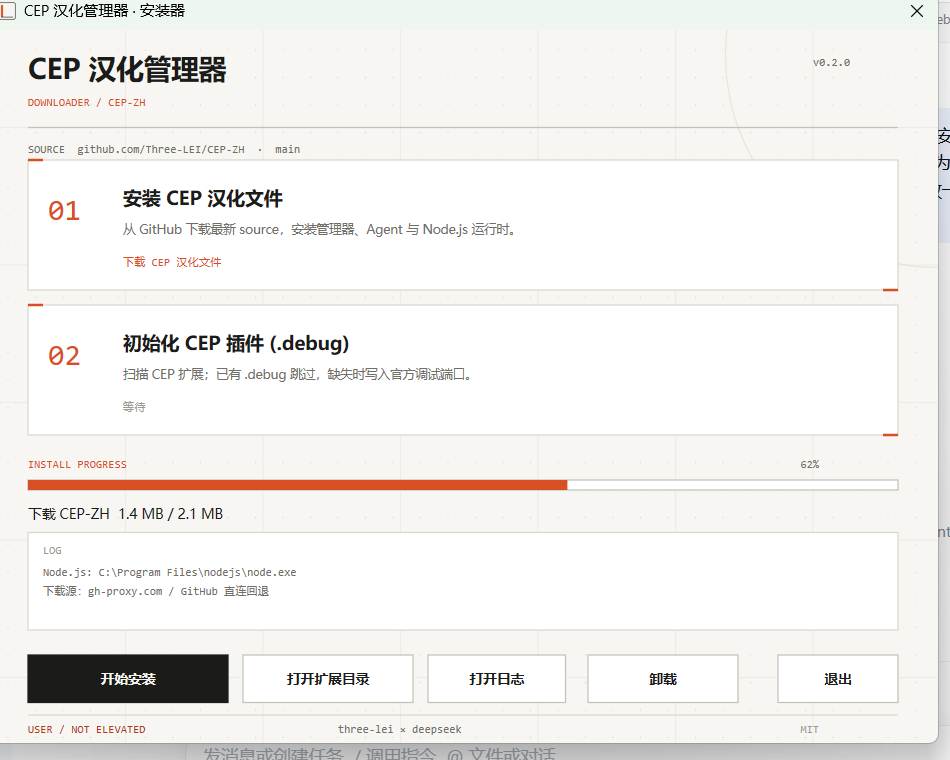

# CEP-ZH 原生安装器（C++ / Direct2D）

一个单文件 Win32 安装器，界面与 CEP 汉化管理面板保持一致：浅色点线风格、固定布局、
① 安装 CEP 汉化文件 → ② 初始化 `.debug`。不把 CEP 文件或 Node 运行时嵌入 exe，
运行时从 GitHub / Node.js 官方源下载。



## 功能

| 功能 | 说明 |
| --- | --- |
| 下载器 | 从 GitHub 仓库下载最新 source，优先 `gh-proxy.com`，回退 `ghproxy.net`、GitHub 直连 |
| Node 运行时 | 系统没有 Node.js 时，自动下载 Node 22.14.0 便携版到 `%LOCALAPPDATA%\CEP-ZH\node`；有系统 Node 则直接复用 |
| 安装管理器 | `product/cep.zh.manager` → `%APPDATA%\Adobe\CEP\extensions\cep.zh.manager` |
| 安装 Agent | `tools/cep-zh` → `%LOCALAPPDATA%\CEP-ZH\agent\tools\cep-zh` |
| CEP12 引擎代理 | 为 CEP12 的 `CEPHtmlEngine` 安装 `VCRUNTIME140_1.dll` 全局代理；之后新装的 CEP12 插件自动获得调试端口 |
| `.debug` 初始化 | 对旧版 CEP 调用 Agent CLI 扫描扩展；已有 `.debug` 跳过，缺失时写入官方调试端口 |
| 桌面图标 | 复制安装器到 `%LOCALAPPDATA%\CEP-ZH\CepZhInstaller.exe`，创建“CEP 汉化管理器”桌面快捷方式 |
| 卸载 | 恢复/删除生成的 `.debug`，恢复 CEP12 引擎代理，移除扩展、Agent、快捷方式和安装器；保留 `%APPDATA%\CEP-ZH` 字典与 AI 配置 |
| 固定窗口 | 760×570 逻辑尺寸，不可拉伸、不可最大化；高 DPI / 小屏幕自动整体缩放适配工作区 |
| 管理员权限 | manifest 为 `requireAdministrator`；写系统扩展目录和 `.debug` 需要 |

## 下载源

```text
1. https://gh-proxy.com/https://github.com/Three-LEI/CEP-ZH/archive/refs/heads/main.zip
2. https://ghproxy.net/https://github.com/Three-LEI/CEP-ZH/archive/refs/heads/main.zip
3. https://codeload.github.com/Three-LEI/CEP-ZH/zip/refs/heads/main
```

Node：

```text
1. https://nodejs.org/dist/v22.14.0/node-v22.14.0-win-x64.zip
2. https://npmmirror.com/mirrors/node/v22.14.0/node-v22.14.0-win-x64.zip
```

第三方代理只做 GitHub 文件传输，安装器不执行代理返回的任何指令；源码和 Node 包仍然走 HTTPS。

## 构建

```powershell
powershell -ExecutionPolicy Bypass -File installer\native\scripts\build.ps1
```

产物：

```text
installer\native\dist\CepZhInstaller.exe
```

构建环境：Visual Studio 2022 Build Tools + MSVC v141 + Windows SDK 10.0.19041 + CMake。
静态 CRT（`/MT`），不依赖 VC++ 运行库；D2D1 / DirectWrite / WinHTTP / miniz。

## 测试参数

```text
--preview     只显示界面，不执行安装
--auto        启动后自动开始安装（开发测试用）
--uninstall   启动后直接进入卸载流程
```

## 卸载后的数据

默认保留：

```text
%APPDATA%\CEP-ZH\config.json
%APPDATA%\CEP-ZH\*.json  字典
```

如需彻底清理，手动删除 `%APPDATA%\CEP-ZH`。生成的 `.debug` 和原文件备份由 Agent CLI 的
`disable` 流程恢复；如果 `.debug` 是扩展作者自带的，不会被删除。

## 已知限制

- 公开仓库不包含 MiSans WOFF2；安装器会保留已有字体目录，首次安装若没有本地字体则回退到系统字体。
- 下载依赖网络；GitHub 代理不可用时回退直连。
- 安装器未做代码签名。
