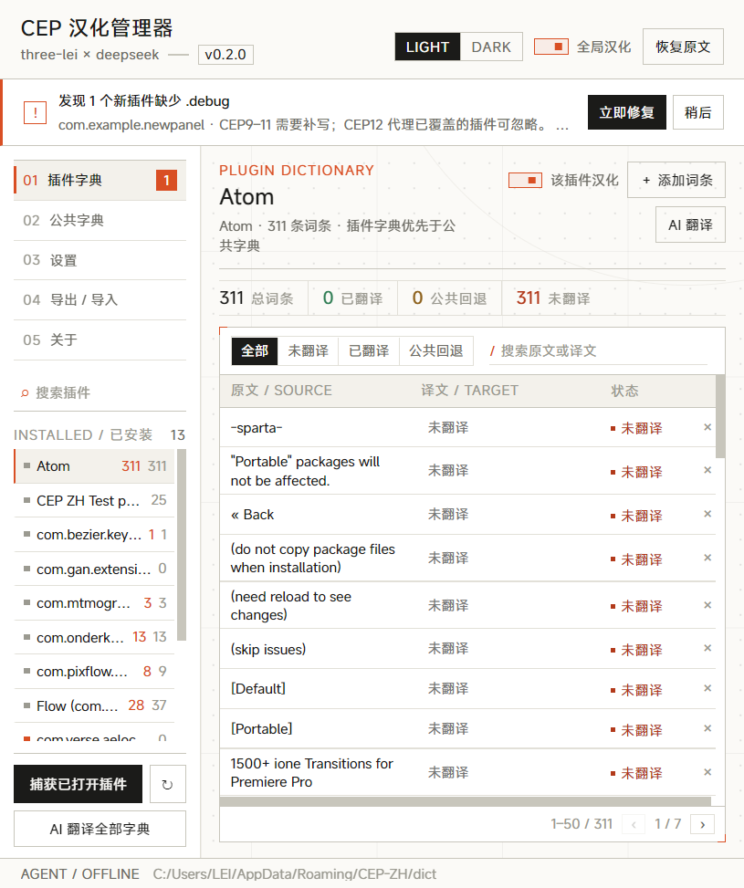

# CEP 汉化管理器（原型）

宿主内可见的 CEP 面板，用来管理：

- 公共字典：`%APPDATA%\CEP-ZH\dict\global.json`
- 插件字典：`%APPDATA%\CEP-ZH\dict\extensions\<bundleId>.json`
- 翻译 API 配置：`%APPDATA%\CEP-ZH\config.json`
- 运行时控制：`%APPDATA%\CEP-ZH\control.json`（全局/单插件开关、捕获 token）
- Agent 状态：`%APPDATA%\CEP-ZH\state.json`（只读，面板轮询）

保存后，正在运行的 cep-zh Agent 会监听目录并热重载，不需要重启宿主。

## 安装

把整个 `cep.zh.manager` 目录复制到：

```text
%APPDATA%\Adobe\CEP\extensions\cep.zh.manager
```

重启 Adobe 应用，打开：

```text
窗口 > 扩展 > CEP 汉化管理
```

菜单名来自 manifest 的 `<Menu>CEP 汉化管理</Menu>`；CEP 的扩展菜单位置由宿主决定，
通常都在“窗口/Window > 扩展/Extensions”下。

## 使用

1. 左侧“插件字典”列出已有 / 运行中的插件，左侧搜索框只筛插件；Agent 会自动捕获新面板的单词，未翻译条目排在最前；
2. 表格中直接改“译文”，失焦或回车自动保存；表格内“搜索原文或译文”只筛当前字典，不会影响左侧插件列表；插件字典优先，空译文回退公共字典；
3. 顶部“全局汉化 / 恢复原文”和单插件开关会写 `control.json`，Agent 通过 `fs.watch` 约 60 ms 内执行；
4. “公共字典”编辑共享词条（同样表格化）；
5. “捕获已打开插件”请求 Agent 重新扫描所有 CEP 面板，只补缺失词条，不覆盖已有翻译；纯中文、纯数字、纯符号会被过滤；
6. “AI 翻译”翻译当前插件，左侧“AI 翻译全部字典”翻译全部插件；只处理空译文，跳过已翻译；
7. “设置”里保存 API 配置（OpenAI 兼容 / DeepL / mock）；
8. “04 导出 / 导入”里勾选插件导出到新文件夹，或选择文件夹批量导入；导入默认不覆盖已有译文；
9. 默认亮色，右上角 LIGHT / DARK 切换；背景为点阵、细线和几何轮廓的“点线面”风格；
10. 标题旁显示 `three-lei × deepseek` 署名与版本号；
11. UI 使用官方 MiSans 字体（Regular/Medium，设置页注明许可）；字号随面板尺寸和系统缩放自动调整（clamp + rem），窄/矮面板自动紧凑，无需手动设置；
12. “05 关于”显示项目信息、GitHub 地址与打开按钮、哔哩哔哩主页跳转按钮；
13. **新增插件检测**：Agent 以首次启动时的扩展路径为基线，之后扫描到新扩展且缺少 `.debug` 时：
   - 用户目录可写时自动补写，并在面板提示“重启 Adobe”；
   - 系统目录需要管理员时，面板顶部显示横幅和侧栏红点，点“立即修复”触发 UAC；
   - 已有开发者 `.debug` 或 CEP12 引擎代理覆盖的插件可忽略。

新增插件的基线保存在 `%APPDATA%\CEP-ZH\debug-baseline.json`，不会把安装前已有的
Adobe 内置扩展全部弹出来。



首次运行会把扩展自带的 `dict/` 默认字典复制到 `%APPDATA%\CEP-ZH\dict`。

> 当前原型只负责编辑/控制和显示状态；真正注入、捕获和 API 调用由 Agent 完成。

## 前置条件

- 需要先让面板拿到调试端口：
  - 推荐：`tools/bootstrap/install-proxy.cmd` 安装引擎代理（一次，零 `.debug`）；
  - 或：`tools/cep-zh/cli.mjs enable` 写 `.debug`（逐扩展）；
- Agent 由 `node tools/cep-zh/cli.mjs agent` 启动（当前外部 Node 原型）。

## 隐藏 Agent 自动启动（原型）

manifest 里还包含一个隐藏扩展 `cep.zh.agent`，随宿主启动，读取：

```text
%APPDATA%\CEP-ZH\config.json
{
  "nodePath": "C:\\...\\node.exe",
  "agentScript": "F:\\...\\tools\\cep-zh\\agent.mjs",
  "extraArgs": ["--verbose"]
}
```

然后用 `spawn` 启动 Agent，`--host-pid` 为 CEP 的 `process.ppid`（宿主 PID）。
状态写在 `%APPDATA%\CEP-ZH\agent\status-<hostPid>.json`，宿主退出时子进程收到 SIGTERM。
实测见 `docs/autostart-evidence.md`。

## 限制

- 隐藏 Agent 目前使用**外部 Node**（配置 `nodePath`）；正式版应内置到 CEP 的 Node/浏览器混合实现；
- 还没有按 `--host-pid` 过滤面板，多个 Adobe 应用同时运行会重复注入；
- CEP 扩展不能注册宿主“顶级菜单”，只能出现在 `窗口 > 扩展`；原生菜单需要各应用插件；
- Manager 必须保持 `AutoVisible=true`；改成 `false` 时从菜单打开会出现“只有 tab、内容空白”
  （CEP 不显示内嵌 CEPHtmlEngine 窗口，但 DOM 实际已加载）。隐藏 Agent 仍保持 `false`；
- API Key 目前明文保存在本机用户目录，正式版应使用 DPAPI 加密；
- 面板没有直接启动 Agent（隐藏扩展负责启动；管理器只显示状态）。
